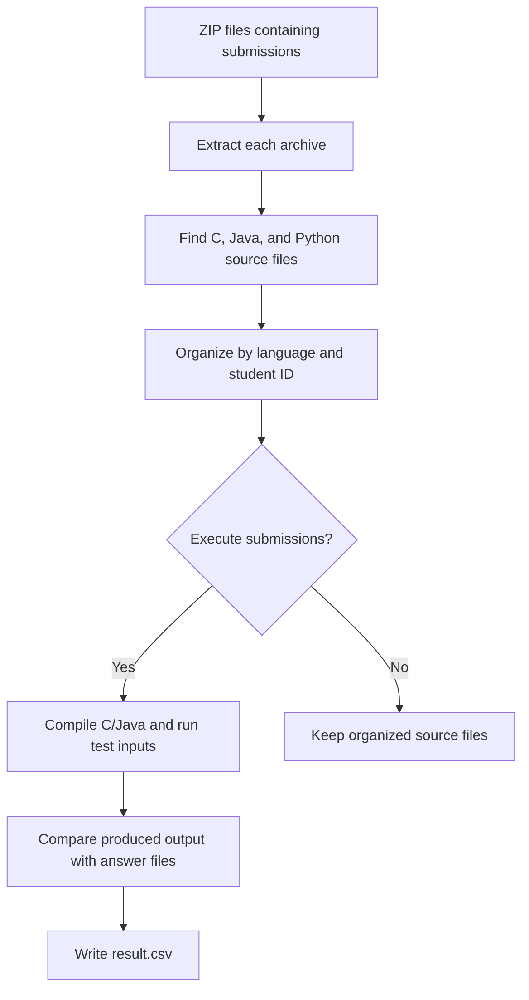
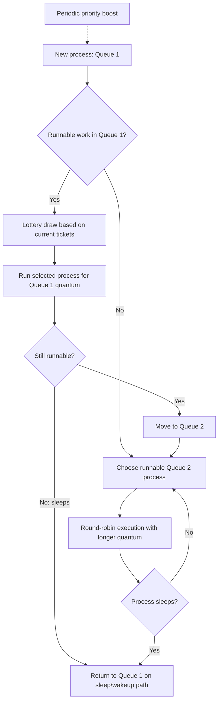
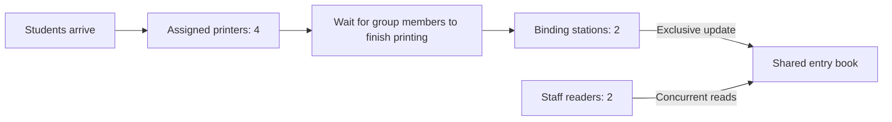

# Operating Systems (CSE 314)

Coursework and implementations from **CSE 314: Operating Systems**, covering shell automation, system calls, CPU scheduling, and concurrent programming. The xv6 exercises modify the **RISC-V xv6 kernel**; the other assignments are standalone Bash and C++ programs.

## Contents

| Assignment | Topic | Implementation |
| --- | --- | --- |
| [Offline 1 — Bash](offline_1_bash/organize.sh) | Shell scripting and automation | Organizes programming submissions, compiles/runs them against test cases, and generates a grading summary. |
| [Offline 2 — System Calls](offline_2_systemcall/1905062_systemcall.patch) | xv6 kernel interfaces | Adds syscall tracing, syscall usage statistics, and a shutdown mechanism. |
| [Offline 3 — Scheduling](offline_3_scheduling/1905062.patch) | CPU scheduling in xv6 | Implements a two-queue scheduler combining lottery scheduling and round-robin scheduling. |
| [Offline 4 — IPC / Synchronization](offline_4_IPC/main.cpp) | Threads and synchronization | Simulates a group printing-and-submission workflow using POSIX threads, mutexes, and semaphores. |

---

## 1. Bash Scripting — Submission Organizer and Grader

**Source:** [`offline_1_bash/organize.sh`](offline_1_bash/organize.sh)

A Bash script for processing collections of student code submissions. It automates much of the work involved in sorting submissions by programming language, running them on supplied test inputs, and comparing their outputs with expected answers.

### Workflow



**Key features**

- Recursively traverses extracted archives and identifies `.c`, `.java`, and `.py` files.
- Moves recognized solutions into language-specific `C`, `Java`, and `Python` directories, grouped by student ID.
- Uses `gcc` for C, `javac`/`java` for Java, and `python3` for Python.
- Redirects each test case into the submitted program and saves its output to a separate file.
- Uses `diff` to check outputs against reference answers.
- Produces a `result.csv` containing `student_id`, `type`, `matched`, and `not_matched`.
- Includes `-v` (verbose) and `-noexecute` options.

### Usage

```bash
cd offline_1_bash
bash organize.sh <submission_folder> <target_folder> <test_folder> <answer_folder> [-v|-noexecute]
```

Example with relative paths:

```bash
bash organize.sh submissions organized tests answers -v
```

To only extract and organize submissions:

```bash
bash organize.sh submissions organized tests answers -noexecute
```

> **Important:** The script **deletes the target folder if it already exists** before reorganizing files. Use a dedicated output directory. It also assumes a particular submission-archive naming convention and test/answer-file naming scheme, so these may need to be adjusted for other datasets.

---

## 2. System Calls — Extending xv6

**Patch:** [`offline_2_systemcall/1905062_systemcall.patch`](offline_2_systemcall/1905062_systemcall.patch)

This assignment extends xv6's syscall dispatch path and provides user-level commands for observing and controlling the operating system.

### System-call tracing: `trace`

Adds a tracing syscall and a `trace` utility that runs another program while monitoring one selected system call number. For traced invocations, the kernel prints the process ID, syscall name, relevant arguments, and return value.

The selected trace ID is stored in the process structure and inherited by a child created with `fork()`.

Example inside a patched xv6 shell:

```text
$ trace 5 ls
```

Here, syscall **5** is `read` in the xv6 syscall numbering used by this patch.

### System-call statistics: `history`

Extends the syscall dispatcher to maintain **invocation counts** and **accumulated execution time (in xv6 timer ticks)**. The kernel measures elapsed ticks around syscall execution and exposes the collected information through a `history` syscall and user utility.

```text
$ history       # show statistics for multiple syscalls
$ history 5     # show statistics for syscall number 5 (read)
```

The implementation maintains kernel-wide counters and copies syscall-statistic snapshots to user space.

### Shutdown: `shutdown`

Adds a shutdown syscall, called by an xv6 user program named `exit`. The kernel sets a timer-interrupt halt flag, with corresponding RISC-V assembly changes to request emulator shutdown.

```text
$ exit
```

**Kernel areas modified:** syscall dispatch and numbering, process metadata, timer-interrupt setup/assembly, system-call handlers, user-level syscall stubs, and xv6 user programs.

---

## 3. CPU Scheduling — Two-Level Lottery and Round Robin

**Patch:** [`offline_3_scheduling/1905062.patch`](offline_3_scheduling/1905062.patch)

Replaces xv6's original process-selection loop with a **two-level scheduling approach**. The higher-priority queue uses ticket-based lottery scheduling, while the lower-priority queue uses round-robin scheduling.

### Scheduling design

| Property | Queue 1 (higher priority) | Queue 2 (lower priority) |
| --- | --- | --- |
| Selection policy | Lottery scheduling | Round robin |
| Configured time quantum | 1 timer tick | 2 timer ticks |
| Selection order | Weighted by remaining tickets | Scans runnable processes in order |
| Transition | A runnable process is moved to Queue 2 after being scheduled | A sleeping process is returned to Queue 1 |



### Implementation details

- **Ticket initialization:** A new process begins with 10 tickets by default.
- **Lottery scheduling:** A random ticket is drawn against the tickets held by runnable Queue 1 processes. A scheduled process consumes a ticket.
- **Round-robin fallback:** When Queue 1 has no runnable tickets, the scheduler considers runnable processes in Queue 2.
- **Time quantum:** The kernel's timer-trap logic supports the one-tick and two-tick queue settings.
- **Ticket replenishment:** Remaining-ticket counts are reset from original ticket allocations when all runnable processes' current tickets are exhausted.
- **Priority boosting:** The implementation periodically moves processes back to Queue 1 at an interval of 64 ticks.
- **Process inheritance:** A forked child inherits its parent's original ticket allocation and starts in Queue 1.
- **Process statistics:** Per-process fields track queue number, original/current tickets, and scheduled time slices.

### Added system calls

| System call | Purpose |
| --- | --- |
| `settickets(int n)` | Sets the calling process's ticket allocation (requires `n > 0`). |
| `getpinfo(struct pstat *info)` | Copies process scheduling information to user space. |

The patch also adds two test utilities:

- `dummyproc`: Creates a CPU-bound workload after setting a specified ticket count.
- `testprocinfo`: Prints the process table's queue, ticket, and time-slice information.

Example inside the patched xv6 shell:

```text
$ dummyproc 20
$ testprocinfo
```

`dummyproc` intentionally runs indefinitely; use a separate xv6 shell/session as needed to inspect scheduling information.

---

## 4. Synchronization — Group Printing and Submission Simulation

**Source:** [`offline_4_IPC/main.cpp`](offline_4_IPC/main.cpp)

A multithreaded C++ simulation of students working in groups to print documents, bind them, and record completed submissions in a shared entry book. The exercise demonstrates POSIX threads and synchronization **within one process** (rather than message passing between separate processes).

### Scenario and resources

- **Students:** `N` student threads, divided into groups of `M` members.
- **Printers:** 4 printers, with printer assignment based on student ID.
- **Binding stations:** 2 stations, shared by all groups.
- **Entry book:** A shared record containing the number of submitted reports.
- **Staff:** 2 reader threads that periodically inspect the entry book.



### Synchronization mechanisms

| Mechanism | Role |
| --- | --- |
| `pthread_create` / `pthread_join` | Create student, binding, and reader threads; wait for finite tasks to finish. |
| Per-printer mutexes | Protect printer state and waiting lists. |
| Per-student semaphores | Coordinate access and handoff at printing stations. |
| Per-group semaphores | Signal that group members have completed printing. |
| Binding semaphore | Restrict simultaneous binding to 2 groups. |
| Entry-book mutex | Ensure only one group writes the shared record at a time. |
| Reader-count mutex | Coordinate concurrent readers using a readers–writers pattern. |

The simulation uses **Poisson-distributed delays** for student arrivals and periodic staff reads. It logs events with their time offset from the start of the simulation.

### Input format

The program reads from **`in.txt`** and writes logs to **`out.txt`**, both relative to the directory in which it is run.

```text
N M w x y
```

- `N`: total number of students
- `M`: number of students per group
- `w`: duration of printing
- `x`: duration of binding
- `y`: duration of entry-book reading/writing

Example input:

```text
8 4 1 2 1
```

### Compile and run

From the repository root:

```bash
cd offline_4_IPC
g++ -std=gnu++17 -pthread main.cpp -o simulation
printf '8 4 1 2 1\n' > in.txt
./simulation
cat out.txt
```

The implementation assumes complete groups (`N` divisible by `M`). As a course simulation, the concurrency code is provided as written; it has not been validated here for every input size or thread interleaving.

---

## Running the xv6 Patches

The two xv6 assignments are provided as **patch files, not complete xv6 source trees**. Apply them to **separate, compatible copies** of the MIT xv6-riscv repository because both patches modify several of the same kernel files.

**Prerequisites:** Linux or an appropriate Linux development environment, a RISC-V cross-compilation toolchain, `make`, and QEMU for RISC-V. The Bash assignment additionally needs Bash, `unzip`, and the compilers/interpreters for its supported languages; the synchronization assignment needs `g++` and pthread support.

For example, from this repository's root:

```bash
# System-call assignment
git clone https://github.com/mit-pdos/xv6-riscv.git xv6-systemcalls
cd xv6-systemcalls
git apply --check ../offline_2_systemcall/1905062_systemcall.patch
git apply ../offline_2_systemcall/1905062_systemcall.patch
make qemu
```

For the scheduler, use a **separate checkout**:

```bash
cd ..
git clone https://github.com/mit-pdos/xv6-riscv.git xv6-scheduling
cd xv6-scheduling
git apply --check ../offline_3_scheduling/1905062.patch
git apply ../offline_3_scheduling/1905062.patch
make qemu
```

> **Compatibility note:** These patches were developed against an earlier xv6-riscv source snapshot. The current upstream `main` branch may differ. If `git apply --check` fails, use the matching older xv6 revision rather than forcing a patch onto incompatible code. The repository does not specify the exact xv6 base commit.

## Technologies and Concepts

**Bash · C · C++ · RISC-V · xv6 · QEMU · POSIX Threads · Mutexes · Semaphores · System Calls · Lottery Scheduling · Round Robin · Readers–Writers Synchronization**

## Notes

These are educational assignments preserved in their submitted form. In particular, the Bash grader assumes a fixed archive layout, the xv6 patches depend on an appropriate upstream revision, and the simulation may require additional testing or fixes for robust execution across different workloads.
